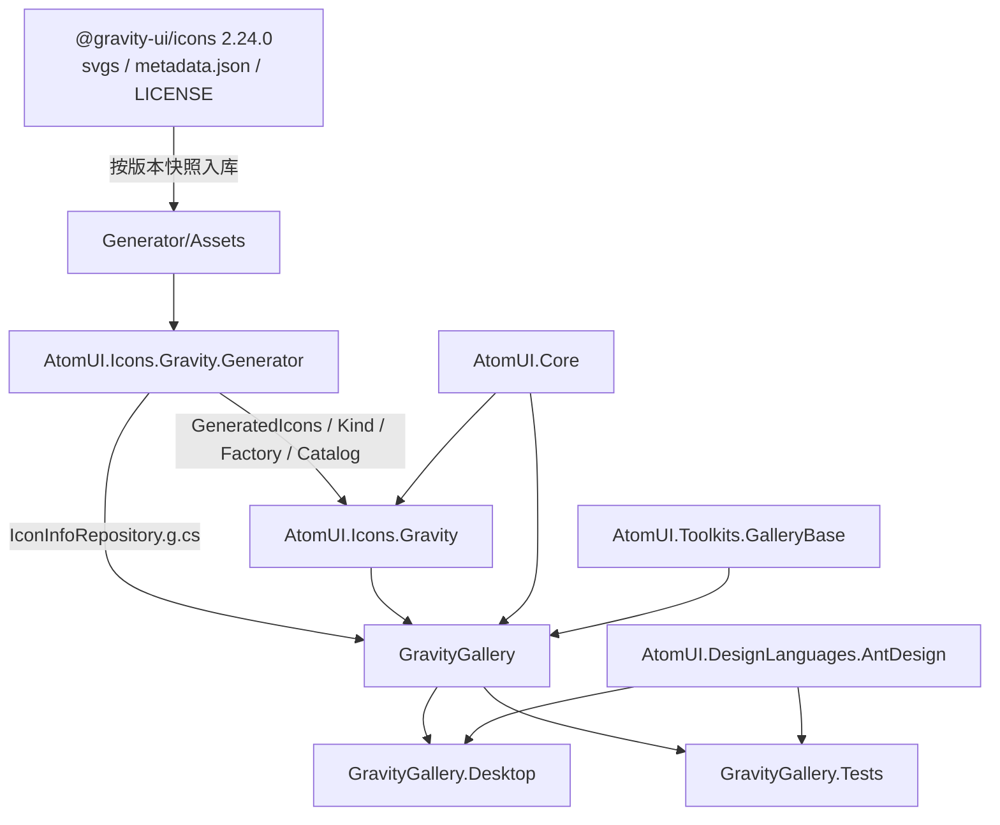

# AtomUI.Icons.Gravity 架构

## 项目范围

本仓把 Gravity UI 图标集 [`@gravity-ui/icons`](https://github.com/gravity-ui/icons)（MIT，Copyright (c) 2022 YANDEX LLC）离线转换为 AtomUI 原生矢量图标包 `AtomUI.Icons.Gravity`，并提供用于浏览、检索和复制图标的 Gallery。工程划分、生成管线与发布方式沿用 `AtomUI.Icons.Material`；图标的数据口径和渲染结果以上游仓库与官方演示站 [gravity-ui.com/icons](https://gravity-ui.com/icons/) 为准。

不在范围内：运行时解析 SVG、16px 以外的图标尺寸、`Filled` 与 `Outlined` 之外的主题、Browser 与移动端宿主。各模块的目录、契约与验收点见[逻辑模块索引](../modules/overview.md)。

## 包与依赖

| 工程 | 内容 | 直接依赖 |
| --- | --- | --- |
| `src/AtomUI.Icons.Gravity.Generator` | 离线生成器与上游资产快照 | `AtomUI.Icons.Shared`、`Avalonia.Headless`、`Avalonia.Skia` |
| `src/AtomUI.Icons.Gravity` | 图标包，唯一的 NuGet 发布物 | `AtomUI.Core` |
| `gallery/GravityGallery` | Gallery 共享库：模块配置、页面、图标控件、本地化 | `AtomUI.Desktop.Controls`、`AtomUI.Toolkits.GalleryBase`、`AtomUI.Icons.AntDesign`、`AtomUI.Icons.Gravity`；构建期 `AtomUI.Generator` |
| `gallery/GravityGallery.Desktop` | 桌面宿主，应用组合根 | `GravityGallery`、`AtomUI.DesignLanguages.AntDesign`†、`AtomUI.Desktop.Controls.Themes.AntDesign`† |
| `tests/GravityGallery.Tests` | 无头测试 | `GravityGallery`、`Avalonia.Headless`、xunit.v3、Shouldly、`AtomUI.DesignLanguages.AntDesign`†、`AtomUI.Desktop.Controls.Themes.AntDesign`† |

† 本设计新增的引用。`GravityGallery` 声明了控件 Token，生成器禁止它引用任何语言包（`ATOMUIGEN053`），所以设计语言只能由宿主启用。

## 依赖关系

## 版本与上游基线

- `AtomUIVersion` 与 `GravityVersion` 均为 `6.3.0`，`AvaloniaVersion` 为 `12.1.6`，即 AtomUI 6.3.0 的精确依赖，见 [build/Version.props](../../build/Version.props)。版本跟 AtomUI 最新稳定版锁步，由 `scripts/release/resolve_release_version.py` 判定。
- 开发在版本分支 `release/6.0` 上进行，与 MaterialIconsPackages 相同。`main` 不承载开发；`v<版本>` 标签打在版本分支上，发布时推送版本分支与标签。
- 上游快照为 `@gravity-ui/icons` `2.24.0`（commit `a479b875c217a1c17881b66a2ff3132fd5161f78`），记录在 `upstream.json`。
- Gallery 迁移到 6.3.0 的依据是 AtomUI 官方的 6.3.0 迁移指南和第三方控件包指南：控件 Token 改为 `partial` 声明加取值规则，设计语言必须显式启用，包入口改为生成器产出的 `PackageMetadata.Definition`。
- Gallery 开始依赖设计语言包之后，发布解析器的同批校验清单 `COHORT_PACKAGES` 需要加入 `AtomUI.DesignLanguages.AntDesign`、`AtomUI.Controls.Themes.AntDesign` 和 `AtomUI.Desktop.Controls.Themes.AntDesign`，否则 AtomUI 的部分发布不会被拦截。

## 与 MaterialIconsPackages 的一致性

以下部分与 Material 相同，本设计不改动：目录与工程划分、共享生成器基类 `DefaultIconPackageGenerator`、发布工作流与发布脚本、Gallery 的信息架构（`Overview`、`Community`、`Categories` 分组）、私有的 `IconGallery` 与 `IconInfoItem` 控件、96 个一批的增量加载、点击复制反馈、四种语言。

| 方面 | Material | Gravity | 原因 |
| --- | --- | --- | --- |
| 图标类命名 | 分类前缀加名称加主题，如 `ActionAlarmOutlined` | 名称加主题，如 `AlarmOutlined` | 上游图标可以属于多个分类，没有唯一前缀 |
| 主题 | 五种 | `Outlined`（上游 `regular`）、`Filled`（上游 `fill`） | 上游只有两种风格 |
| 默认主题 | `Filled` | `Outlined` | 816 个图标中 737 个是 `regular` |
| 几何缩放 | zoom-to-fit，让图形充满视图框 | 不缩放，按上游 viewBox 渲染 | 16px 网格上的留白是图标设计的一部分 |
| 生成的 `CreateInstance()` | 未重写 | 重写 | 避免克隆时抛 `NotSupportedException` |
| 设计语言 | 在共享库的 `ConfigureCore` 里设初始主题 | 由桌面宿主与测试宿主显式启用 Ant Design | 6.3.0 要求显式启用，且控件包不得引用语言包 |
| 分类数据来源 | 由资产目录名推导 | 上游 `metadata.json` 的 `categories` | 上游提供结构化元数据 |
| 分类归属 | 每个图标一个分类 | 每个图标出现在它的所有分类下 | 与官方演示站一致 |
| 搜索字段 | 类名 | 类名、上游名、关键词 | 与官方演示站一致 |
| 标题栏 Theme 菜单 | 6.2 时代的四项开关：`Dark Mode` 是复选框，没有主题色入口 | 对齐 6.3.0 的 AtomUI Gallery：设计语言、品牌色、中性色、外观三态、其他主题 | 与框架 Gallery 保持一致 |

## 现状

以下为 2026-11-26 的实测结果。修复 Gallery 的改动在工作区中，尚未提交。

- 上游资产与上游 2.24.0 逐字节一致；重跑生成器后，受版本控制的生成物零差异；图标包与生成器两个工程 0 警告 0 错误。
- Gallery 已迁移到 AtomUI 6.3.0、适配 Gravity 的分类，标题栏 Theme 菜单也已对齐 AtomUI Gallery：Debug 与 Release 全量构建均为 0 错误 0 警告，41 个测试在两种配置下全部通过。
- 概览页目前使用一张过渡横幅（暗底、红色光晕、标题与五个 Gravity 字形），正式素材待提供（决策 D11）。
- 设计中的其余变更尚未实施：多分类归属与关键词、`All` 聚合条目、画布裁剪、红点画刷、包内许可通知，以及删除旧的 `GalleryControlThemesProvider`。
- Gallery 尚未做过真机视觉验收。

## 决策记录

“默认采用”的决策按所列结论设计，等待确认；“待提供”的决策需要你给出输入后才能完成对应模块。

| 编号 | 决策 | 结论 | 状态 |
| --- | --- | --- | --- |
| D1 | 版本基线 | AtomUI `6.3.0`、Avalonia `12.1.6` 锁步 | 已定，`Version.props` 已是此值 |
| D2 | 上游风格到 `IconThemeType` 的映射 | `regular` 对应 `Outlined`，`fill` 对应 `Filled` | 已定，已落地 |
| D3 | 几何缩放 | 不做 zoom-to-fit | 已定，已落地 |
| D4 | 设计语言的启用位置 | 桌面宿主与测试宿主启用 Ant Design 并登记取值包 | 已实施，测试通过 |
| D5 | 取值规则形态 | 通用规则，绑定 `LanguageDesignToken` | 已实施，测试通过 |
| D6 | 旧的 `GalleryControlThemesProvider` | 删除 | 已验证为冗余，尚未删除 |
| D7 | 默认主题 | `Outlined` | 已实施，待确认 |
| D8 | “全部图标”聚合入口 | 在 `Categories` 分组下增加 `All` 条目 | 默认采用，待确认 |
| D9 | 图标中的红色圆点 | 映射到次级填充画刷，未设置时回退为红色 | 默认采用，待确认 |
| D10 | 分类的导航图标 | 沿用 Ant Design | 已实施，待确认 |
| D11 | 概览页横幅素材 | 1536×512 的 WebP | 已放入过渡素材，正式素材待提供 |
| D12 | 关键词的展示 | 参与搜索，并在图标卡片的工具提示中显示 | 默认采用，待确认 |
| D13 | 标题栏 Theme 菜单 | 对齐 6.3.0 的 AtomUI Gallery，主题菜单从框架 Gallery 移植 | 已实施，测试通过 |

## 建议实施顺序

1. 恢复到可构建、可启动（已完成，横幅为过渡素材）：[Gallery 图标控件与主题](../modules/gallery-controls/design.md)、[本地化](../modules/localization/design.md)、[Gallery 应用与页面](../modules/gallery-app/design.md) 三个模块的 6.3.0 迁移与分类适配。正式横幅素材到位后，概览页才能通过视觉验收。
2. 对齐官方数据口径：[上游资产与代码生成器](../modules/icon-generator/design.md) 与 [Gallery 目录域](../modules/gallery-catalog/design.md)。
3. 适配并补充测试：[测试](../modules/testing/design.md)。
4. 保真度与许可：[图标包](../modules/icon-package/design.md) 的画布裁剪、次级画刷与包内许可通知。
